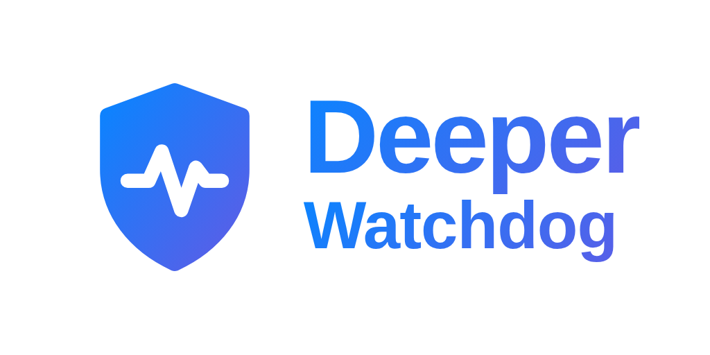
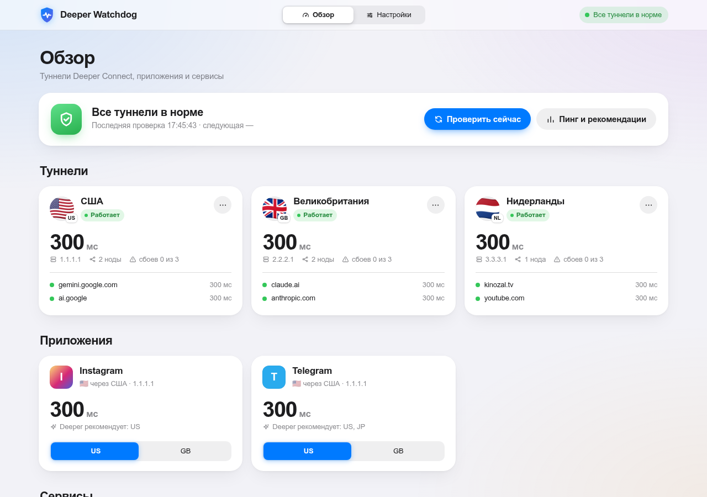
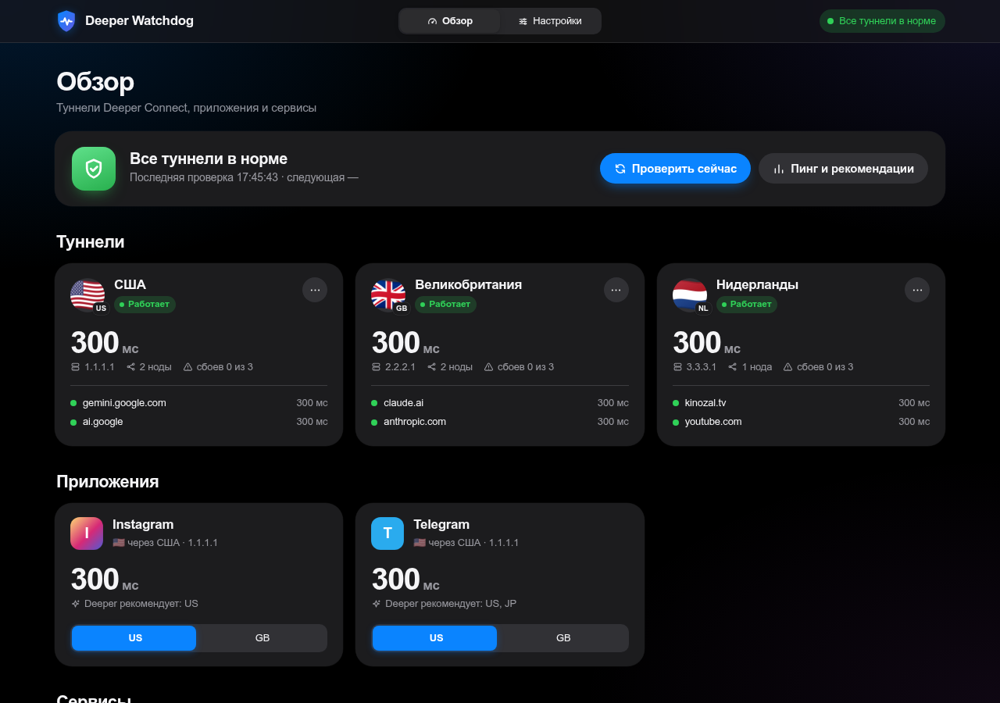
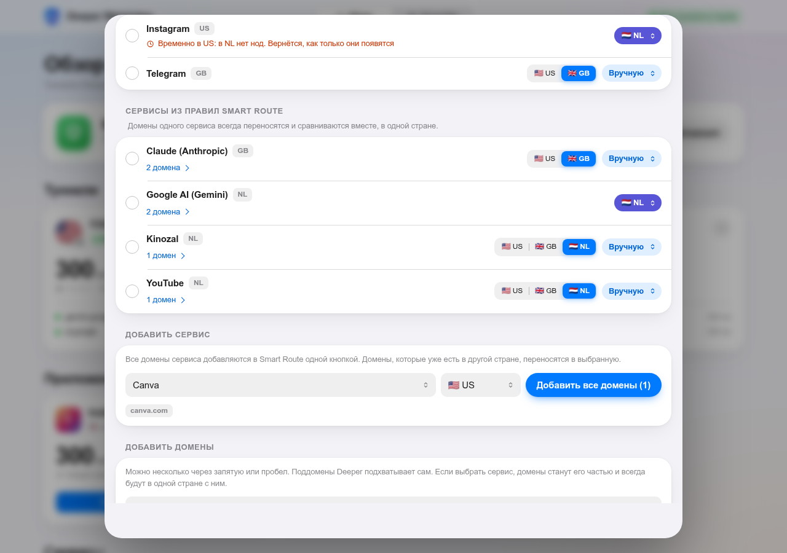

<p align="center"></p>

<p align="center">
  <b>Следит за туннелями Deeper Connect и сам их чинит.</b><br>
  Меняет ноды, перестраивает туннели, переносит сервисы туда, где они работают, и сообщает об этом на почту и телефон.
</p>

<p align="center">
  <a href="https://github.com/escvratar/deeper-watchdog/releases/latest"></a>
  
  
  <a href="LICENSE"></a>
</p>

<p align="center"><i>Watchdog for Deeper Connect tunnels: latency and download checks, node switching, tunnel rebuilds,
moving services to a working tunnel, email and phone notifications. Docker or plain Python; web UI in RU / EN / 中文.</i></p>

<p align="center">
  
  
</p>

## Возможности

| | |
|---|---|
| 🔍 **Проверка по-настоящему** | Каждый домен Smart Route и сайт приложения меряется через свой туннель: пинг, потери, ошибки и загрузка страницы (DPI «замораживает» соединения при хорошем пинге). |
| 🛠 **Лечение лесенкой** | Сначала смена ноды, потом переезд только плохих сервисов, перестроение туннеля — последнее средство. Все туннели медленные сразу — виновата сеть, ничего не трогается. |
| 🚚 **Сервисы переезжают сами** | Режимы «Авто», «Вручную» и 📌 предпочтительные туннели по порядку. Без «пинг-понга»: переезд после 2 плохих проверок из 3, возврат после 5 минут нормы. |
| ⚡ **Туннель без нод** | Нод нет — сервисы уходят сразу, 📌 возвращаются, когда ноды появятся. Ноды проверяются каждые 10 секунд. |
| 📊 **Удобный веб-интерфейс** | Четыре вида главной страницы, светлая и тёмная тема, RU / EN / 中文, история пинга, журнал с фильтрами, ручное сравнение туннелей. |
| 🔔 **Уведомления** | На почту и в приложение для Android — по выбранным событиям, в том числе вне дома. |
| 💾 **Резервные копии** | Копия правил Deeper перед каждым изменением, экспорт и импорт настроек. |

<p align="center"></p>

## Установка

Нужен Deeper Connect, **через который идёт трафик устройства с Watchdog** (схема «модем → Deeper → роутер»):
он меряет туннели своими запросами. Запускайте **только одну копию** — две будут мешать друг другу.

Всё скачивается со страницы **[Releases](https://github.com/escvratar/deeper-watchdog/releases/latest)**:

| Куда | Что скачать | Как |
|---|---|---|
| 🖥 Сервер, NAS, роутер с Docker — **с компьютера на Windows** | `deeper-watchdog-install-windows.bat` | Запустить, выбрать «по SSH», ввести адрес устройства. Можно и в Docker Desktop на этом же ПК |
| 🖥 То же — **с Linux или macOS** | `deeper-watchdog-install-linux.sh` | `sh deeper-watchdog-install-linux.sh` |
| 📱 То же — **с телефона** | `deeper-watchdog.apk` | При первом запуске: «Установить на сервер» |
| 🐧 Прямо на сервере / роутере | `dw-install.sh` | `curl -fsSL https://github.com/escvratar/deeper-watchdog/releases/latest/download/dw-install.sh -o dw.sh && sh dw.sh` |
| 💻 Windows **без Docker** | `deeper-watchdog-portable-windows.zip` | Распаковать, `Start.bat`. Python уже внутри |
| 💻 Linux / macOS **без Docker** | `deeper-watchdog-portable-linux.tar.gz` | Распаковать, `./run.sh` (нужен Python 3.8+) |

Установщик сам всё проверит и подскажет: найдёт Docker (Synology, QNAP, Xiaomi, обычный Linux) или поставит его,
спросит пароль sudo, проверит, отвечает ли Deeper и свободен ли порт, скачает образ, дождётся запуска,
**проверит пароль Deeper** и покажет адрес. Повторный запуск — обновление, состояние или удаление.

<details>
<summary><b>Вручную: Docker Compose, docker run, Portainer</b></summary>

Образ `ghcr.io/escvratar/deeper-watchdog:latest` собирается для x86-64, ARM64 и ARMv7.

```bash
git clone https://github.com/escvratar/deeper-watchdog.git && cd deeper-watchdog
cp .env.example .env && nano .env      # DEEPER_PASS — пароль Deeper Connect
docker compose up -d                   # обновление: docker compose pull && docker compose up -d
```

```bash
docker run -d --name deeper-watchdog --restart unless-stopped -p 8787:8787 \
  -v /opt/deeper-watchdog/data:/data \
  -e DEEPER_HOST=34.34.34.34 -e DEEPER_PASS='пароль Deeper' -e TZ=Europe/Moscow \
  ghcr.io/escvratar/deeper-watchdog:latest
```

В Portainer / Container Manager: образ выше, порт 8787 → 8787, папка → `/data`, переменные `DEEPER_PASS`
(и при необходимости `DEEPER_HOST`, `TZ`), перезапуск `unless-stopped`.
</details>

Затем откройте `http://IP-устройства:8787` — первая страница попросит придумать пароль входа.
Остальное настраивается в веб-интерфейсе без перезапуска.

## Приложение для Android

[`deeper-watchdog.apk`](https://github.com/escvratar/deeper-watchdog/releases/latest/download/deeper-watchdog.apk) · Android 8.0+

- Веб-интерфейс с запомненным входом, скачивание и загрузка файла настроек.
- **Установка на сервер** при первом запуске: приложение само подключится по SSH и поставит Watchdog в Docker.
- **Уведомления** о выбранных событиях (проверка не прошла, переезд, нет нод, Deeper недоступен…), раз в 15 минут.
  По доменному имени с HTTPS (например, обратный прокси Synology) работают и вне дома.

## Настройка

| Где | Что |
|---|---|
| Веб-интерфейс → Настройки | Всё: допустимый пинг, интервалы, способы проверки, режимы сервисов, перестроение, почта, вид, доступ |
| `.env` | Адрес и пароль Deeper, начальные значения настроек |
| `data/` | Настройки из веб-интерфейса (главнее `.env`), журнал, история, резервные копии |

> Почта (Яндекс, Mail.ru, Gmail) требует **пароль приложения**, а не пароль от ящика.

<details>
<summary><b>Как проверяются туннели</b></summary>

- Туннель проверяется по всем своим доменам Smart Route и сайтам приложений; туннель без сервисов — только по числу нод.
- Каждый домен меряется 3 раза (1–5), в пинг идёт лучший замер. Пинг туннеля — медиана того, что в нём работает.
- 3 домена туннеля за проверку (по очереди; зависшие — каждый раз) скачивают страницу до 64 КБ. Обрыв засчитывается,
  только если повторное скачивание тоже оборвалось.
- Домен плохой, если не ответил, медленнее допустимого пинга или отдал 403/429/5xx, которых обычно не отдаёт.
  Сайты, всегда отвечающие 403, и домены, молчащие везде 2 дня, не в счёт.
- Способ проверки — общий и у каждого сервиса: «Страница» (по умолчанию), «Соединение» (только TCP) и для Telegram
  «Серверы Telegram». У TCP-способов свой допустимый пинг (400 мс). «Диагностика…» меряет всеми способами сразу.
- «Если плохо части сервисов»: «Сначала уезжают плохие» (по умолчанию; сбой туннеля — когда плохо больше половины
  сервисов), «Быстрый уход очень плохих», «Только статистика».
- Плохо большинству сервисов — меняется нода; одному-двум — переезжают только они. Если Deeper возвращает туннель
  на плохую ноду, Watchdog снова уходит с неё.
- Перестроение — только если в туннеле не осталось сервисов, не чаще раза в 2 часа на туннель; можно выключить.
</details>

<details>
<summary><b>Режимы сервисов</b></summary>

Сервис работает плохо, если его пинг выше допустимого, потери больше 20%, нет ответа, не грузится страница или
домены отдают ошибки — в 2 из 3 последних проверок. Переезжает он только туда, где есть ноды.

- **Авто** — при плохой связи или без нод уезжает в лучший туннель и остаётся там. Без причины не переезжает.
  Если плохо и на новом месте — обходит туннели (по 5 минут), возвращается в лучший из опробованных и ждёт новую ноду.
- **Вручную** — никогда не переносится сам; при сбое приходит письмо.
- **📌 Предпочтительные туннели** — по порядку. Уходит в следующий из списка, возвращается вверх, когда туннель
  5 минут в норме (и только на другую ноду, если уходил из-за плохой связи).
- **✨ Лучший из списка** — для сервиса с несколькими предпочтительными туннелями (в меню режима или для всех:
  «Настройки → Предпочтительные туннели»). Раз в час (10–1440 мин) сервис меряется в каждом туннеле списка и
  остаётся там, где ему заметно лучше (быстрее на 30% и 200 мс или меньше потерь). При сбое уходит в лучший по
  последним замерам, без замеров — по порядку списка. Выключено — обычная лестница.

Домены одного сервиса переносятся вместе; сервис с тем же названием, что приложение, следует за приложением.
</details>

<details>
<summary><b>Полезные команды</b></summary>

```bash
docker logs -f deeper-watchdog                                                # журнал
docker exec deeper-watchdog python /app/deeper_watchdog.py --test-only        # разовая диагностика
docker exec deeper-watchdog python /app/deeper_watchdog.py --switch NL        # сменить ноду туннеля
docker exec deeper-watchdog python /app/deeper_watchdog.py --refresh NL       # перестроить туннель
python3 deeper_watchdog.py --setup                                            # настройка без Docker
```

Сборка приложения без Android Studio: `android/build.sh`. Сборка релизных файлов: `install/build.sh`.
Тесты (без сети, Deeper и почты): `python3 -m unittest discover tests`.
</details>

## Безопасность

- `.env` и `data/` содержат пароли — не публикуйте их (они в `.gitignore`).
- Пароль веб-интерфейса хранится только как хеш; сменить его (нужен текущий) и выйти на всех устройствах —
  «Настройки → Доступ». Забыли — удалите `data/web_auth.json`.
- После 5 неверных паролей подряд вход с этого адреса закрыт на минуту — и через форму, и через HTTP Basic.
- **Не открывайте порт 8787 в интернет.** Для доступа вне дома — обратный прокси с HTTPS или VPN до дома.
- Почта отправляется только серверу с действительным сертификатом (SSL и STARTTLS).
- Установщики передают пароли через SSH-сессию, а не командной строкой, и удаляют себя после работы.
  Приложение показывает отпечаток ключа устройства и отправляет пароли только после подтверждения;
  если ключ потом изменится, оно спросит снова.

## Лицензия

[MIT](LICENSE). Проект не связан с Deeper Network; Deeper Connect — их торговая марка.
