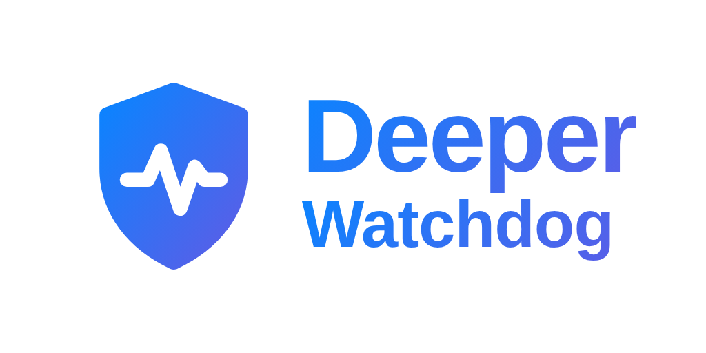
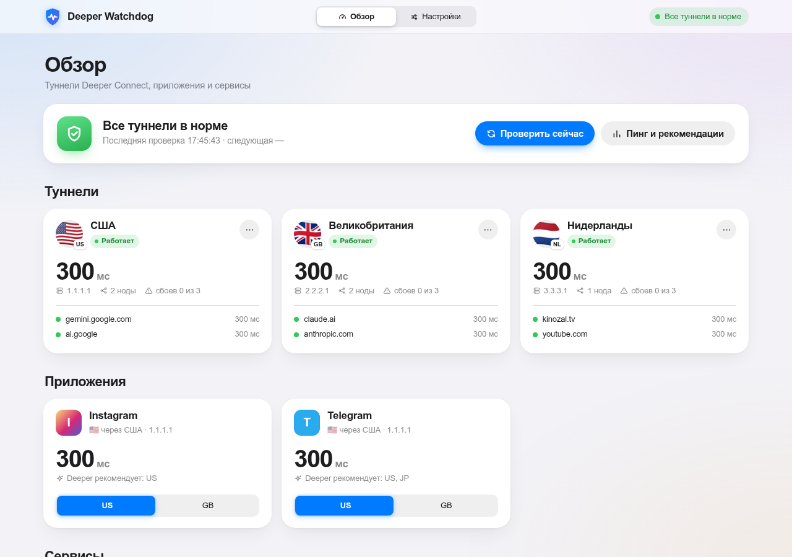
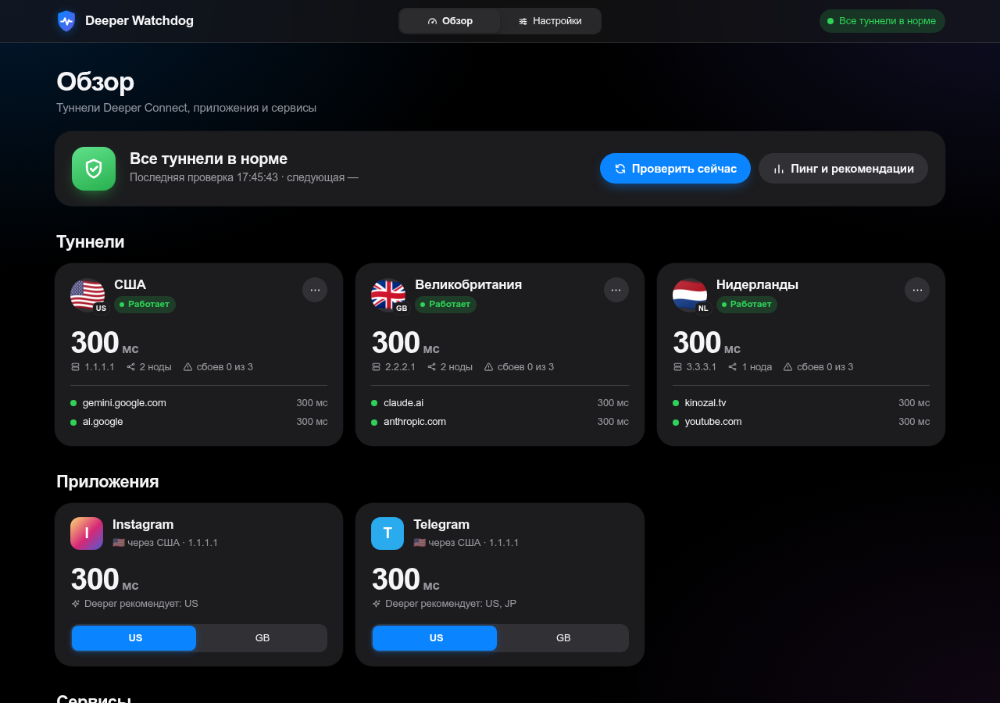
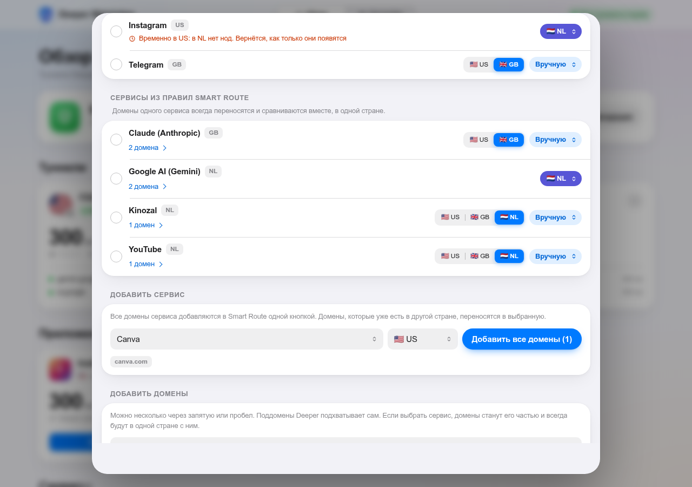

<p align="center"></p>

# Deeper Watchdog

Следит за туннелями [Deeper Connect](https://deeper.network) и сам чинит их: меняет ноды, перестраивает туннели,
переносит сервисы туда, где пинг меньше, и присылает отчёты на почту. Работает в Docker, например на Synology NAS.
Веб-интерфейс в стиле Apple, светлая и тёмная тема, удобно с телефона.

*Watchdog for Deeper Connect tunnels: monitors latency, switches nodes or rebuilds failing tunnels, moves services to the fastest tunnel, and emails reports. Runs in Docker; web UI in Russian.*

<p align="center">
  
  
</p>

## Возможности

- **Проверка туннелей по всем доменам.** Каждую проверку меряются все домены Smart Route и сайты приложений, каждый
  через свой туннель. Замер идёт по фазам: TCP-рукопожатие к порту 443, время до первого байта (TTFB), потери, коды
  ошибок (403, 429, 5xx, сброс TLS). Туннель сбойный, если плохая хотя бы половина его доменов: плохая нода тормозит
  всё сразу, а пара плохих сайтов — проблема самих сайтов. Пинг туннеля — медиана его доменов.
- **Куда переезжать** выбирается по пингу и потерям: из туннелей, чей пинг не дальше 50 мс от самого быстрого,
  выигрывает тот, где меньше потерь.
- **Восстановление лесенкой: сначала переносы, перестроение — последнее средство.** Туннель не прошёл 2 проверки
  подряд → из него уезжают сервисы (кроме «Вручную»), и они сразу снова работают. 3 проверки → смена ноды, до 2 раз.
  Не помогло → перестроение, но только если в туннеле не осталось сервисов, не чаще раза в 2 часа на туннель
  (настраивается), по одному туннелю и не чаще раза в 10 минут вообще. Если медленные сразу все туннели, виновата
  скорее сеть: ноды не меняются и туннели не перестраиваются, но сервисы, которые плохо работают, всё равно
  переезжают туда, где есть ноды. Перестроение можно выключить совсем.
- **Туннель без нод.** Число нод проверяется каждые 10 секунд. Через минуту без нод сервисы уходят в работающий
  туннель (📌 возвращаются, когда ноды появятся). Сам туннель перестраивается, только если нод нет больше часа:
  Deeper добирает ноды сам, а перестроение сбрасывает их.
- **Переезд только когда нужно.** Сервис переходит в другой туннель при двух условиях сразу: в его туннеле плохая
  связь или нет нод, и в новом туннеле есть ноды. Просто потому, что где-то быстрее, сервисы не переезжают.
  Три режима: «Авто» (по умолчанию), «Вручную» и предпочтительный туннель 📌.
- **Без «пинг-понга».** Переезд после 2 плохих проверок из 3 последних, а не после одного сбоя; после переезда сервис
  5 минут не трогается (кроме полной потери связи); в 📌 сервис возвращается, когда туннель 5 минут подряд в норме.
- **Ручное сравнение туннелей.** Кнопкой «Сравнить» сервис по очереди переносится в каждый туннель, меряется и
  возвращается на место; сравнение только показывает, где лучше, переносите вы сами.
- **Сервисы из правил Smart Route.** Домены одного сервиса (например, все домены Gemini) всегда переносятся вместе.
  Каталог популярных сервисов добавляется одной кнопкой.
- **Резервные копии правил** перед каждым изменением, экспорт и импорт настроек.
- **Журнал событий** с автоочисткой, история пинга за сутки.
- **Письма на почту** по выбранным событиям: восстановление, туннель без нод, автоперенос, недоступность Deeper и другие.

<p align="center"></p>

## Установка

Нужен Docker и Deeper Connect, **через который идёт трафик этого устройства** (схема «модем → Deeper → роутер»
или устройство за Deeper): watchdog меряет пинг своими запросами, и они должны проходить через туннели.
Запускайте только одну копию: две будут мешать друг другу, переключая ноды и перенося сервисы.

Готовый образ `ghcr.io/escvratar/deeper-watchdog:latest` собирается для x86-64, ARM64 (роутеры, Raspberry Pi 4/5,
большинство NAS) и ARMv7 — Docker сам выберет нужный.

### Docker Compose

```bash
git clone https://github.com/escvratar/deeper-watchdog.git
cd deeper-watchdog
cp .env.example .env
nano .env            # DEEPER_PASS — пароль Deeper Connect
docker compose up -d
```

Обновление: `docker compose pull && docker compose up -d`. Собрать образ из исходников: `docker compose up -d --build`.

### docker run (без Compose)

```bash
mkdir -p /opt/deeper-watchdog/data
docker run -d --name deeper-watchdog --restart unless-stopped \
  -p 8787:8787 \
  -v /opt/deeper-watchdog/data:/data \
  -e DEEPER_HOST=34.34.34.34 \
  -e DEEPER_PASS='пароль Deeper Connect' \
  -e TZ=Europe/Moscow \
  ghcr.io/escvratar/deeper-watchdog:latest
```

Вместо `-e` можно передать файл: `--env-file .env` (шаблон — `.env.example`).
Обновление: `docker pull ghcr.io/escvratar/deeper-watchdog:latest`, затем `docker rm -f deeper-watchdog` и тот же `docker run`.

### Роутер или NAS с Docker в веб-интерфейсе (Portainer, Container Manager и т. п.)

1. **Образ:** `ghcr.io/escvratar/deeper-watchdog:latest` (в Portainer: Containers → Add container → Image).
2. **Порт:** 8787 (хост) → 8787 (контейнер).
3. **Том:** папка на USB-диске или в хранилище → `/data`, чтобы настройки переживали обновление.
4. **Переменные окружения:** `DEEPER_PASS`, при необходимости `DEEPER_HOST`, `TZ`.
5. **Перезапуск:** `unless-stopped` (или «Always»).

Откройте `http://IP-устройства:8787`. Все остальные настройки меняются в веб-интерфейсе без перезапуска.

На Synology: Container Manager → Проект → Создать, путь к папке с `docker-compose.yml` и `.env`.

## Настройка

| Где | Что |
|---|---|
| `.env` | Адрес и пароль Deeper Connect, начальные значения остальных настроек |
| Веб-интерфейс → Настройки | Допустимый пинг, интервал проверки, замеров за проверку, сколько плохих проверок до сбоя сервиса и туннеля и до смены ноды, приложения, перестроение туннелей (вкл/выкл и как часто), почта |
| `data/settings.json` | Сохранённые из веб-интерфейса значения, имеют приоритет над `.env` |

«Сброс настроек» в веб-интерфейсе удаляет сохранённые значения и возвращает значения из `.env`;
сервисы, режим «Авто» и предпочтительные туннели при этом остаются.

> Почтовые сервисы (Яндекс, Mail.ru, Gmail) требуют **пароль приложения**, а не основной пароль от ящика.

### Как проверяются туннели

- Туннель проверяется по всем своим доменам Smart Route и сайтам своих приложений. Туннель, через который не идёт
  ни один сервис, не проверяется: за ним следят только по числу нод.
- Каждый домен меряется 3 раза за проверку (настраивается, 1–5), в пинг идёт лучший замер, в потери — неудачные
  (за последние 5 проверок).
- Домен плохой, если не ответил, медленнее «Допустимого пинга» или отдал ошибку 403/429/5xx, которой обычно не
  отдаёт. Сайт, который всегда отвечает 403 (защита от ботов), за это не штрафуется. Домены, которые 2 дня не
  отвечают ни в одном туннеле (например, голые CDN-домены), не в счёт.
- Сбой туннеля — когда плохих не меньше половины его доменов.
- После смены ноды или перестроения история туннеля сбрасывается: новая нода — новый маршрут.
- Сбой засчитывается не чаще раза за интервал проверки, поэтому «3 сбоя подряд» — это минуты, а не секунды.

### Режим сервиса

Сервис работает плохо, если его пинг (среднее по его доменам) выше «Допустимого пинга», потери
больше 20%, нет ответа или большинство его доменов отдают ошибку — в 2 из 3 последних проверок (настраивается):
так переезжает и сервис на грани порога, который то чуть выше, то чуть ниже. Сервис, который давно не отвечает нигде,
тоже пробуется в других туннелях; если не ответил ни в одном, остаётся на месте до появления новой ноды. Переезжает он только туда, где есть ноды: сначала в туннель, где ноды держатся
дольше 5 минут, потом в рабочий и самый быстрый. Если нод нет больше нигде, остаётся на месте.

**Обход туннелей.** Если сервису плохо и на новом месте, он едет дальше — в следующий туннель с нодами, где ещё не
был; в каждом проводит не меньше 5 минут, результат (медиана пинга за это время) запоминается. Как только где-то
хорошо, обход заканчивается. Если хорошо не было нигде, сервис возвращается в лучший из опробованных и остаётся там,
пока где-нибудь не появится нода с новым IP: туннель с новой нодой снова пробуется, остальные — нет.

- **Авто** (по умолчанию для всех) — при плохой связи или без нод переезжает в лучший туннель с нодами и остаётся
  там. Без причины не переезжает, даже если где-то быстрее.
- **Вручную** — никогда не переносится сам, даже из туннеля без нод. При сбое приходит письмо.
- **📌 Туннель** — предпочтительный: при сбое или пропаже нод сервис временно уезжает и возвращается, когда туннель
  5 минут подряд в норме. Если он уходил из-за плохой связи, то вернётся только на другую ноду: IP ноды, где ему
  было плохо, запоминается на сутки. Если вскоре снова пришлось уйти, следующее ожидание вдвое дольше (до часа).

## Полезные команды

```bash
docker logs -f deeper-watchdog                                                    # логи
docker exec -it deeper-watchdog python /app/deeper_watchdog.py --test-only        # разовая диагностика
docker exec -it deeper-watchdog python /app/deeper_watchdog.py --switch NL        # сменить ноду туннеля
docker exec -it deeper-watchdog python /app/deeper_watchdog.py --refresh NL       # перестроить туннель
docker exec -it deeper-watchdog python /app/deeper_watchdog.py --test-email      # тестовое письмо
```

## Безопасность

- Не публикуйте `.env` и папку `data/`: там пароли, почта и ваши правила. Оба исключены в `.gitignore`.
- Пароли в экспортируемом файле настроек не сохраняются.
- **Пароль веб-интерфейса** задаётся при первом открытии страницы после развёртывания контейнера и хранится только
  в виде хеша (`data/web_auth.json`). Каждое устройство вводит его один раз; сменить пароль и выйти на всех
  устройствах можно в «Настройки → Доступ». Забыли пароль — удалите `data/web_auth.json` и задайте новый.
  Можно задать его и в `.env` как `WEB_PASSWORD`: тогда он меняется только там.
- Не открывайте порт 8787 в интернет.

## Лицензия

[MIT](LICENSE). Проект не связан с Deeper Network; Deeper Connect — их торговая марка.
